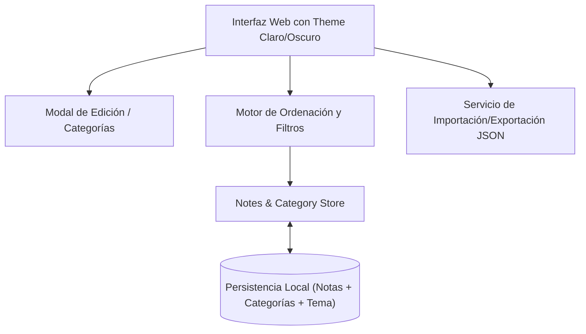

# Implementation Plan: Gestor de Tareas y Notas Inteligente (v2 - Expansión)

**Branch**: `001-task-notes-manager` | **Date**: 2026-11-20 | **Spec**: [spec.md](file:///D:/CBD/IA-LAB/SpecKit/specs/001-task-notes-manager/spec.md)

---

## 1. Summary (v2)
Integración de las 6 funcionalidades solicitadas:
1. Modal de edición para notas existentes.
2. Selector de fecha límite (`due_date`) con lógica de advertencia de vencimiento.
3. Barra de control con selector de ordenación (`SortEngine`).
4. Sistema dinámico de categorías (`CategoryManager`) con selector de color.
5. `ThemeService` con soporte completo para Tema Claro / Tema Oscuro mediante variables CSS.
6. `BackupService` para exportación directa a archivo `.json` e importación mediante `FileReader`.

---

## 2. Updated Architecture & Flow

