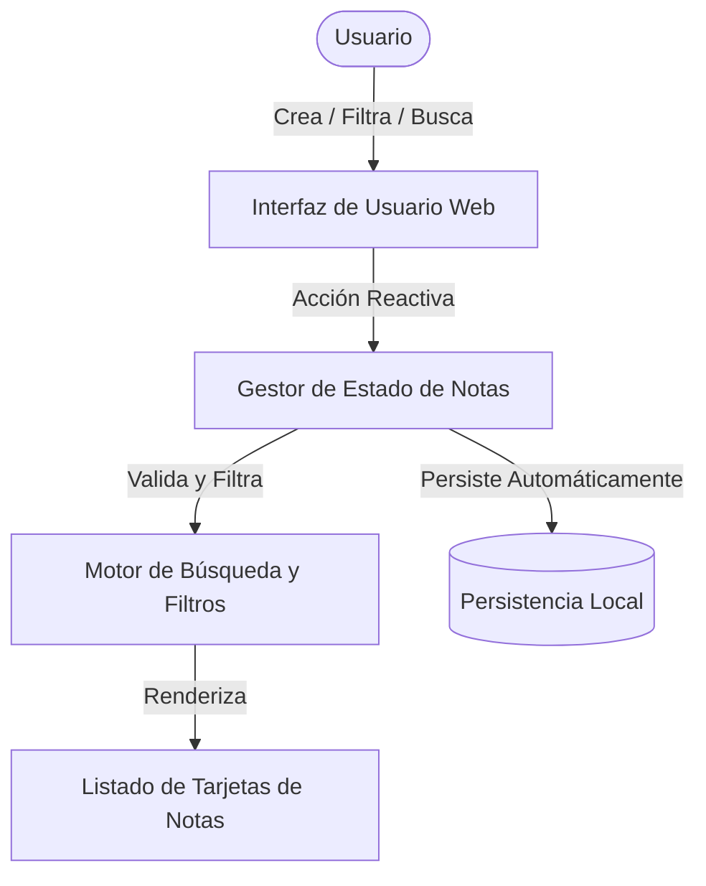

# Implementation Plan: Gestor de Tareas y Notas Inteligente

**Branch**: `001-task-notes-manager` | **Date**: 2026-11-20 | **Spec**: [spec.md](file:///D:/CBD/IA-LAB/SpecKit/specs/001-task-notes-manager/spec.md)

---

## 1. Summary
Construir una aplicación interactiva, moderna y ligera para la gestión de notas y tareas. Proporciona una interfaz limpia con categorización por insignias de colores (Urgente, Trabajo, Personal), filtrado reactivo en tiempo real y persistencia local para funcionar sin dependencias complejas.

---

## 2. Technical Context

* **Architecture**: Frontend Web interactivo moderno (Single Page Application autónoma con HTML5, TailwindCSS / CSS moderno y JavaScript modular) + opción de Backend API ligero en Python (FastAPI/SQLite) si se desea sincronización servidor.
* **Storage**: Almacenamiento local persistente (`localStorage` en navegador / `SQLite` en local).
* **Target Platform**: Cualquier navegador moderno en Windows, macOS o Linux, ejecutable con 1 clic sin configuraciones pesadas.
* **Performance**: Tiempo de respuesta < 20ms para filtrado y ordenación; carga instantánea.

---

## 3. Architecture & Data Flow



---

## 4. Component Structure

```text
src/
├── index.html        # Estructura principal y controles visuales
├── app.js            # Lógica de estado, filtros, ordenación y persistencia
├── styles.css        # Diseño visual pulido (modo oscuro/claro, badges de color)
└── storage.js       # Capa de almacenamiento y serialización
```
